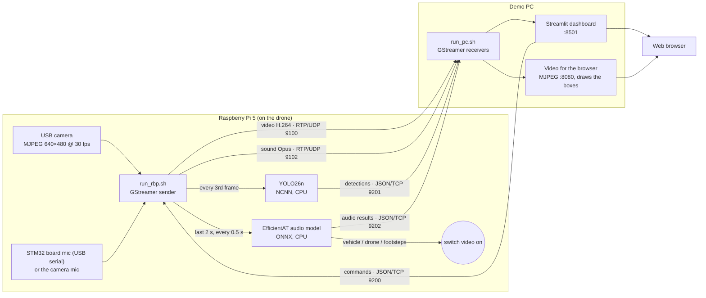

# Demo pipeline: Raspberry Pi on the drone → Demo PC

The Raspberry Pi on the drone films with a USB camera and runs the **YOLO26n**
object detector on its own CPU. It streams **video, sound and detections** to
the Demo PC over Wi‑Fi. The Demo PC shows everything in a web dashboard
(Streamlit) and can send commands back to the Pi (`LANDING`, `STRIKE`).

This is the "RaspberryPi (target confirmation, image recognition)" and
"Demo PC" part of [Demo.drawio](Demo.drawio.png).

*Last checked working end to end: 21 Nov 2026 (Raspberry Pi 5, 8 GB, no AI accelerator).*

---

## 1. Quick start (hardware already set up)

1. Power the drone. On the Pi, the sender starts by itself at boot (systemd service `edth-rbp`, see section 7).
2. On the Demo PC, from the repository root:

   ```bash
   ./demo/scripts/run_pc.sh
   ```

3. Open **http://localhost:8501** (`run_pc.sh` usually opens it by itself). The audio panel updates twice a second.
   Video only starts when the audio model hears a vehicle, drone or footsteps (see below), then shows green detection boxes.

Nothing showing? See section 10.

---

## 2. How it fits together



**On the Pi**, one program (`run_rbp.sh`) does everything:

1. reads the microphone (the STM32 board when `AUDIO_INPUT_FORMAT=stm32`), compresses it to Opus and sends it to the Demo PC;
2. every 0.5 s, if the sound is louder than `AUDIO_RMS_WAKE_THRESHOLD`, runs the audio model on the last 2 s and sends the result to the PC;
3. when the model gives vehicle, drone or footsteps ≥ `AUDIO_VEHICLE_PROB_THRESHOLD`, switches the camera on; it switches off again `VIDEO_WAKE_HOLD_SECONDS` after the last such result;
4. while the camera is on: compresses its JPEG frames to H.264, sends them as RTP over UDP, and copies every 3rd frame to YOLO26n, whose boxes go to the PC;
5. listens for commands from the Demo PC.

If the camera is missing or fails, the audio part keeps running and the Pi tries the camera again 5 s later.

**On the Demo PC**, `run_pc.sh` receives and decodes the video and sound. It
draws the boxes onto the video and serves the dashboard.

### Network ports

| Port | Protocol | Direction | Carries |
|---|---|---|---|
| 9100 | UDP (RTP) | Pi → PC | Video, H.264 |
| 9102 | UDP (RTP) | Pi → PC | Sound, Opus, 48 kHz mono |
| 9201 | TCP | Pi → PC | Detections, one JSON line per analysed frame |
| 9202 | TCP | Pi → PC | Audio model results, one JSON line every 0.5 s |
| 9200 | TCP | PC → Pi | Commands (`LANDING`, `STRIKE`), JSON |
| 8080 | HTTP | PC → browser | Video with boxes drawn (MJPEG), shown inside the dashboard |
| 8501 | HTTP | PC → browser | Streamlit dashboard |

Both machines must be on the same network. The PC must accept incoming
traffic on 9100, 9102, 9201 and 9202 (firewall, section 10).

### Messages (for teams that want to plug in)

Detections, Pi → PC, TCP 9201, one line per analysed frame. Coordinates are
in pixels of the camera frame:

```json
{"frame_w": 640, "frame_h": 480,
 "detections": [{"xyxy": [12.0, 4.5, 105.2, 470.1], "conf": 0.76, "cls": 39, "label": "bottle"}]}
```

Commands, PC → Pi, TCP 9200. Send one JSON line; the Pi answers with one line:

```text
→ {"cmd": "LANDING"}
← {"ack": "LANDING", "ok": true}
```

For now the Pi only logs commands (`_on_command` in
[demo/raspberry/main.py](../demo/raspberry/main.py)). That function is where
flight-controller actions go.

---

## 3. Code map

| File | Runs on | Role |
|---|---|---|
| [demo/scripts/run_rbp.sh](../demo/scripts/run_rbp.sh) | Pi | Starts the sender (`demo.raspberry.main`) |
| [demo/raspberry/gst_sender.py](../demo/raspberry/gst_sender.py) | Pi | Camera and mic → H.264/Opus → RTP; feeds frames to YOLO |
| [demo/raspberry/yolo_detector.py](../demo/raspberry/yolo_detector.py) | Pi | Runs YOLO (Ultralytics) on one frame |
| [demo/raspberry/detection_sender.py](../demo/raspberry/detection_sender.py) | Pi | Sends the detections to the PC (TCP) |
| [demo/common/control.py](../demo/common/control.py) | both | Command server (Pi) and client (PC) |
| [demo/scripts/run_pc.sh](../demo/scripts/run_pc.sh) | PC | Starts the dashboard (`streamlit run demo/pc/main.py`) |
| [demo/pc/gst_receiver.py](../demo/pc/gst_receiver.py) | PC | RTP → decoded video (JPEG) and sound |
| [demo/pc/detection_receiver.py](../demo/pc/detection_receiver.py) | PC | Receives the detections |
| [demo/pc/mjpeg_server.py](../demo/pc/mjpeg_server.py) | PC | Video with boxes for the browser |
| [demo/config.py](../demo/config.py) | both | All settings, read from `demo/.env` |
| [demo/raspberry/web_stream.py](../demo/raspberry/web_stream.py) | Pi | Optional: camera straight to a browser, no PC app (section 8) |

---

## 4. Setting up the Raspberry Pi (once)

Tested on Raspberry Pi OS 12 (bookworm), 64‑bit, Python 3.11.

**1. System packages.** These install GStreamer, its Python bindings and the
camera tools:

```bash
sudo apt install python3-gi gir1.2-gstreamer-1.0 gir1.2-gst-plugins-base-1.0 \
  gstreamer1.0-tools gstreamer1.0-plugins-base gstreamer1.0-plugins-good \
  gstreamer1.0-plugins-ugly gstreamer1.0-pulseaudio v4l-utils ffmpeg
```

**2. Python environment for YOLO.** Create it with `--system-site-packages`
so it can see the GStreamer bindings installed by apt in step 1:

```bash
python3 -m venv --system-site-packages ~/yolo26
~/yolo26/bin/pip install torch torchvision --index-url https://download.pytorch.org/whl/cpu
~/yolo26/bin/pip install "ultralytics>=8.4" ncnn
```

About 1.5 GB. Check that everything imports:

```bash
~/yolo26/bin/python -c "import gi; gi.require_version('Gst','1.0'); from gi.repository import Gst; import ultralytics, ncnn; print('ok')"
```

**3. The code.** Clone or copy the repository to `~/EDTH-TargeTeam`.

**4. Convert the model to NCNN** (section 9 explains why):

```bash
cd ~/EDTH-TargeTeam
~/yolo26/bin/yolo export model=models/vision/yolo26n.pt format=ncnn imgsz=640
# creates models/vision/yolo26n_ncnn_model/
```

The export needs the `pnnx` package. Ultralytics installs it by itself when
the Pi has internet; otherwise run `~/yolo26/bin/pip install pnnx`.

**5. Find the camera.** Use the first `/dev/videoN` listed under the USB
camera's name (the second one is metadata, not video). Then check that it
offers MJPEG at 640×480:

```bash
v4l2-ctl --list-devices
v4l2-ctl -d /dev/video0 --list-formats-ext | grep -A1 640x480
```

**6. Settings:** create `demo/.env` (section 6).

---

## 5. Setting up the Demo PC (once)

The PC needs GStreamer with its Python bindings, plus Streamlit. It doesn't
need YOLO or PyTorch.

**macOS (tested):**

```bash
brew install gstreamer pygobject3
# pygobject3 is built for one Homebrew Python version; find which:
ls -d "$(brew --prefix)"/lib/python3.*/site-packages/gi     # e.g. .../python3.15/...
"$(brew --prefix)"/bin/python3.15 -m venv --system-site-packages demo/.venv   # same version
demo/.venv/bin/pip install streamlit numpy matplotlib sounddevice pillow
```

**Linux (Debian/Ubuntu; same packages, not tested here):**

```bash
sudo apt install python3-gi gir1.2-gstreamer-1.0 gir1.2-gst-plugins-base-1.0 \
  gstreamer1.0-plugins-base gstreamer1.0-plugins-good gstreamer1.0-plugins-bad gstreamer1.0-libav
python3 -m venv --system-site-packages demo/.venv
demo/.venv/bin/pip install streamlit numpy matplotlib sounddevice pillow
```

Then create `demo/.env` (section 6).

---

## 6. Settings (`demo/.env`)

Each machine has its **own** `demo/.env`, copied from
[demo/.env.example](../demo/.env.example). The file isn't committed. The
`run_*.sh` scripts read it at start.

| Setting | Used on | What to put |
|---|---|---|
| `PYTHON_BIN` | both | The Python of the environment above: `~/yolo26/bin/python` (full path) on the Pi, `demo/.venv/bin/python` (full path) on the PC. Not in `.env.example`; add it at the top |
| `PC_HOST` | Pi | **The PC's IP address.** Where video, sound and detections are sent |
| `RBP_HOST` | PC | **The Pi's IP address.** Where commands are sent |
| `PC_PUBLIC_HOST` | PC | Address the browser uses to reach the PC's video: `127.0.0.1` if the browser runs on the PC, otherwise the PC's IP |
| `VIDEO_DEVICE` | Pi | Camera, e.g. `/dev/video0` (section 4, step 5). The example file says `/dev/video4`, which is wrong on our Pi |
| `VIDEO_WIDTH` / `VIDEO_HEIGHT` / `VIDEO_FPS` | Pi | `640` / `480` / `30`. Must be an MJPEG mode the camera offers |
| `AUDIO_INPUT_FORMAT` / `AUDIO_DEVICE` | Pi | `stm32` for the STM32 board ([stm32/mic_stream](../stm32/mic_stream/README.md)), or `pulse` / `default` for the system's default mic |
| `STM32_MIC_PORT` / `STM32_MIC_BAUD` | Pi | Empty (auto-detect the board's ST-LINK port) / `1000000` |
| `AUDIO_RMS_WAKE_THRESHOLD` | Pi | `0.03` (−30 dBFS). Quieter sound is reported as background without running the model |
| `AUDIO_VEHICLE_PROB_THRESHOLD` / `VIDEO_WAKE_HOLD_SECONDS` | Pi | `0.5` / `10.0`: when the camera goes on, and how long it stays on |
| `AUDIO_EVENT_MODEL_PATH` / `AUDIO_EVENT_MEL_BASIS_PATH` | Pi | `models/audio/raspberry_pi/efficientat_audio_v1.onnx` / `.../mel_basis.npy` |
| `YOLO_MODEL_PATH` | Pi | `models/vision/yolo26n_ncnn_model`, relative to the repository root |
| `YOLO_FRAME_INTERVAL` | Pi | `3` = analyse every 3rd frame (10 per second at 30 fps) |
| `YOLO_CONFIDENCE` / `YOLO_IOU` / `YOLO_MAX_DET` | Pi | `0.4` / `0.5` / `20` |
| `CONTROL_PORT`, `VIDEO_RTP_PORT`, `AUDIO_RTP_PORT`, `DETECTION_PORT`, `AUDIO_RESULT_PORT`, `VIDEO_HTTP_PORT` | both | Keep the defaults; they must be the same on both sides |

`YOLO_CONF`, `YOLO_IMGSZ` and `DETECTOR_SOURCE` belong to a different program
(`run_detector.sh`, section 11), not to `run_rbp.sh`.

**If an IP address changes** (Wi‑Fi addresses can), update `PC_HOST` on the
Pi and `RBP_HOST` on the PC, then restart both sides. To find the addresses:
`hostname -I` on the Pi, `ipconfig getifaddr en0` on a Mac, `hostname -I` on
Linux.

---

## 7. Running

**Pi side, by hand** (for testing; stop the service first if it's running):

```bash
cd ~/EDTH-TargeTeam && ./demo/scripts/run_rbp.sh          # Ctrl+C to stop
./demo/scripts/run_rbp.sh --fake                          # test pattern + beep, no camera or mic needed
```

A good start prints `Sender status: {'video_running': True, 'audio_running': True, ..., 'yolo_enabled': True}`.

**PC side:**

```bash
./demo/scripts/run_pc.sh       # then open http://localhost:8501
```

The PC starts receiving only once the dashboard page is open in a browser.

### Start at boot on the Pi (systemd)

The Pi side runs as a systemd **user** service. It's a user service, not a
system one, because the microphone goes through PipeWire, which runs in the
user's session. Use the commands **without `sudo`**: `sudo systemctl` looks
for a system service and won't find it.

`~/.config/systemd/user/edth-rbp.service`:

```ini
[Unit]
Description=EDTH demo, Pi side: camera + mic -> RTP to the PC, YOLO26n detections (run_rbp.sh)
# the mic goes through PipeWire, which runs in this user session
After=pipewire-pulse.socket wireplumber.service
Wants=pipewire-pulse.socket
# never give up restarting (e.g. camera unplugged for a while)
StartLimitIntervalSec=0

[Service]
WorkingDirectory=%h/EDTH-TargeTeam
# settings (PC_HOST, camera, model, Python) come from demo/.env, read by the script
ExecStart=%h/EDTH-TargeTeam/demo/scripts/run_rbp.sh
Environment=PYTHONUNBUFFERED=1
# "always": the program exits with code 0 when the camera or mic pipeline dies
Restart=always
RestartSec=5
TimeoutStopSec=10

[Install]
WantedBy=default.target
```

Install it once:

```bash
systemctl --user daemon-reload
systemctl --user enable --now edth-rbp
sudo loginctl enable-linger "$USER"     # start at boot even when nobody logs in
```

Daily use:

```bash
systemctl --user status edth-rbp          # running? last log lines
systemctl --user start | stop | restart edth-rbp
systemctl --user enable | disable edth-rbp     # start at boot or not
journalctl --user -u edth-rbp -f          # live log
journalctl --user -u edth-rbp -b          # log since boot
```

Restart it after changing `demo/.env`, the code or the model. If it crashes
or the camera is unplugged, it restarts by itself 5 s later.

---

## 8. Camera in a browser, without the PC app (optional)

[demo/scripts/run_web_stream.sh](../demo/scripts/run_web_stream.sh) serves the
camera directly from the Pi: open `http://<PI_IP>:8080/` from any device on
the network. It passes the camera's own JPEGs through without re-encoding, so
it uses almost no CPU. There is no YOLO and no sound. It reads `VIDEO_DEVICE`,
the size and `VIDEO_HTTP_PORT` from `demo/.env`.

```bash
systemctl --user stop edth-rbp            # the camera can only be used by one program
./demo/scripts/run_web_stream.sh          # options: --width 1280 --height 720 --fps 30
```

---

## 9. The detection model

- **Model:** YOLO26n (Ultralytics, 2026). "n" is the smallest size: 2.4 M weights.
  [models/vision/yolo26n.pt](../models/vision/yolo26n.pt) is the standard
  version trained on COCO (80 everyday classes: person, car, bird,
  airplane…). **It has no "drone" class**, so it has to be fine-tuned on drone
  images for the real use.
- **Why NCNN:** NCNN is an inference engine built for ARM CPUs. It runs the same
  weights about 4× faster than PyTorch on the Pi, with the same results
  (table below).
- **Using a newly trained model** (e.g. `best.pt` from training):

  ```bash
  ~/yolo26/bin/yolo export model=best.pt format=ncnn imgsz=640   # creates best_ncnn_model/
  # in demo/.env on the Pi:  YOLO_MODEL_PATH=<path>/best_ncnn_model
  systemctl --user restart edth-rbp
  ```

  Keep the folder name ending in `_ncnn_model`: Ultralytics recognises the
  format by it. Export at 640, because
  [yolo_detector.py](../demo/raspberry/yolo_detector.py) doesn't pass an image
  size and Ultralytics then uses 640. To run at a smaller size (faster, but
  small distant objects get harder to see), export at that size and pass
  `imgsz=` in `yolo_detector.py`.

### Measured on the Raspberry Pi 5 (8 GB, CPU only)

| What | Result |
|---|---|
| YOLO26n, PyTorch `.pt`, 640 px | 277 ms per frame, about 3.6 per second |
| YOLO26n, NCNN, 640 px | 78 ms per frame, about **13 per second** |
| YOLO26n, NCNN, 320 px | 23 ms per frame, about 43 per second |
| Full demo (`run_rbp.sh`, 640×480 @ 30 fps, YOLO on every 3rd frame) | PC receives about 28 video frames/s and 9 detection messages/s; Pi uses about 2.7 of its 4 CPU cores |
| `run_web_stream.sh`, 640×480 | About 17 frames/s reached a laptop over Wi‑Fi (short test); almost no CPU |

All measured on 21 Nov 2026. YOLO rows: median of 30 runs on Ultralytics' sample image, including image loading and pre/post-processing.

---

## 10. When something doesn't work

| Symptom | Likely cause | Fix |
|---|---|---|
| `Device or resource busy` | Another program has the camera | `fuser -v /dev/video0` shows which one. Usually the service: `systemctl --user stop edth-rbp` |
| Dashboard says "Waiting for video stream…" | PC firewall blocks incoming UDP | macOS: click **Allow** when asked whether Python may accept incoming connections (System Settings → Network → Firewall). Linux: allow 9100/udp, 9102/udp, 9201/tcp |
| Same | `PC_HOST` on the Pi isn't the PC's current IP | Fix it in the Pi's `demo/.env`, then `systemctl --user restart edth-rbp` |
| Same | Pi side not running | `systemctl --user status edth-rbp`; `journalctl --user -u edth-rbp -n 50` |
| Video but no boxes | YOLO didn't load | Pi log shows `YOLO model not found` (wrong `YOLO_MODEL_PATH`) or `YOLO disabled: …` (wrong `PYTHON_BIN`, Ultralytics missing) |
| Landing / Strike: "command failed" | `RBP_HOST` on the PC is wrong, or the Pi side isn't running | Fix `RBP_HOST`; check the service |
| `Namespace Gst not available` | GStreamer bindings missing, or the environment can't see them | Install `gir1.2-gstreamer-1.0`; create the environment with `--system-site-packages` |
| `no element "x264enc"` / `"pulsesrc"` | GStreamer plugins missing on the Pi | `sudo apt install gstreamer1.0-plugins-ugly gstreamer1.0-pulseaudio` |
| Service shows `activating (auto-restart)` again and again | It crashes at start | `journalctl --user -u edth-rbp -n 50`, then try `run_rbp.sh` by hand to see the error |
| `Failed to connect to bus` with `systemctl` | Used `sudo`, or logged in as another user | Run `systemctl --user …` without `sudo`, as the user that owns the service |

---

## 11. Other programs in `demo/` (not part of this pipeline)

There is a second, separate path that is in progress. In it, an audio model
wakes up the visual detector:

| Script | What it does |
|---|---|
| [run_audio_wake.sh](../demo/scripts/run_audio_wake.sh) | Listens to the mic at 32 kHz and, every 0.5 s, scores the last 2 s with the EfficientAT model in `models/audio/raspberry_pi` (classes: background, vehicle, drone, footsteps; about 10 ms per window on the Pi). When the drone probability (`AUDIO_WAKE_CLASSES`) is at least `AUDIO_WAKE_THRESHOLD` (default 0.5), it sends a UDP "wake" message to port 9300 on the Pi itself. Add `--verbose` to print every class's probability, or `--wav clip.wav` to replay a recording |
| [run_detector.sh](../demo/scripts/run_detector.sh) | YOLO on the camera, but only for `WAKE_HOLD_SECONDS` after a wake. Logs detections; doesn't stream to the PC |

`run_detector.sh` needs the camera, so it can't run while `run_rbp.sh` does.
`run_audio_wake.sh` only reads the mic. Through PipeWire, it can share the mic with `run_rbp.sh`.

Model files, contract and how to test them: [models/audio/README.md](../models/audio/README.md).

The STM32 microphone board (B-L475E-IOT01A) plugs into the Pi by USB and streams raw 32 kHz audio,
using the firmware in [stm32/mic_stream](../stm32/mic_stream/README.md). Use it with
`./demo/scripts/run_audio_wake.sh --device stm32 --verbose`, and record clips with
`python -m demo.raspberry.audio_wake.stm32_mic --record clip.wav`.
